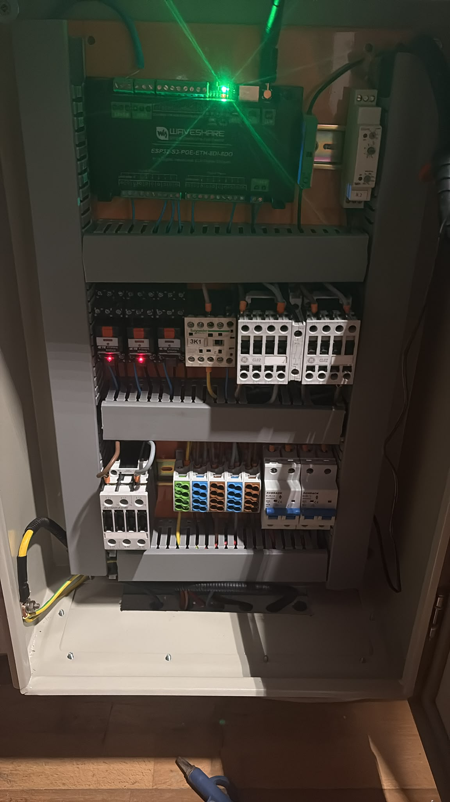

# Coordonarea alimentării și a legăturii N–PE pentru un Growatt folosit ca UPS

**Realizatorul instalației: Ghiulaiu Florin Daniel**  
**Versiunea documentației: 1.0 · 18 noiembrie 2026**

## Rezumat

Este prezentat un studiu de caz privind utilizarea unui controler WaveShare ESP32-S3-POE-ETH-8DI-8DO, programat în ESPHome, pentru coordonarea a trei comenzi într-un sistem UPS bazat pe Growatt: alimentarea AC de intrare, conectarea ieșirii către consumatori și tratarea nulului. Sistemul include și o cale de bypass prin AAR, cu doi contactori interblocați conform descrierii realizatorului. Integrarea Home Assistant completează controlul local prin afișarea stărilor și a parametrilor disponibili.

Documentul separă comportamentul demonstrabil din configurație de funcțiile declarate ale cablajului și de performanțele care necesită verificare prin măsurători. Nu sunt prezentate rezultate experimentale inventate și nu este pretinsă conformitatea întregului tablou pe baza unei fotografii.

**Cuvinte-cheie:** Growatt, UPS, nul, N–PE, RCD, ESPHome, Home Assistant, contactori, interblocare, AAR.

## 1. Context și obiective

O instalație cu invertor și baterie are mai multe regimuri relevante: alimentare AC disponibilă, funcționare autonomă pe baterie, consumatori deconectați și bypass. Simpla existență a tensiunii la ieșire nu descrie complet starea instalației. Este necesară și documentarea modului în care sunt coordonate comenzile și referința față de conductorul de protecție.

În proiectul de față, scopul declarat este folosirea Growatt ca UPS cu stocare. Alimentarea sa AC poate fi furnizată de sistemul DEYE. În această documentație, absența alimentării AC a Growatt și absența rețelei naționale nu sunt tratate ca evenimente obligatoriu identice.

Obiectivele sunt: separarea funcțiilor de comandă; execuția locală a secvențelor; supravegherea din Home Assistant; descrierea căii de bypass; evidențierea verificărilor electrice necesare.

## 2. Diferențiale, nul flotant și traseul curentului de defect

O protecție diferențială urmărește dezechilibrul dintre curenții care trec prin conductoarele active monitorizate. Pentru un circuit monofazat, curentul care pleacă pe fază și revine pe nul se compensează în funcționare normală. O întoarcere pe un alt traseu poate produce un curent rezidual detectabil.

Într-o sursă flotantă, primul defect spre pământ poate avea un curent limitat de impedanțele și capacitățile sistemului. Nu se poate presupune declanșarea diferențialei ca într-o schemă cu sursă referențiată corespunzător. Legătura N–PE la sursă, acolo unde schema și producătorul o cer, contribuie la formarea traseului de defect prin PE. Ea nu înlocuiește continuitatea PE sau protecțiile.

Legătura trebuie coordonată cu regimul de alimentare, fără legături N–PE paralele neprevăzute. Documentația Victron explică acest principiu și comutarea legăturii la unele invertoare/încărcătoare; este o referință conceptuală, **nu aprobarea acestei soluții pentru Growatt**. [S1]

## 3. De ce nu formulăm o regulă universală despre nulul flotant

Acest articol urmărește protecția instalației de locuință în configurația declarată. Nu afirmă că orice sistem flotant este greșit: schemele IT constituie o categorie distinctă, care necesită proiectare și protecții potrivite. Nici nu afirmă că realizarea oricărei punți N–PE face automat instalația sigură. Aplicabilitatea la modelul și versiunea exactă Growatt trebuie stabilită din documentația producătorului și din schema instalației.

Înainte de publicarea unei scheme de cablare executabile trebuie stabilite regimul de împământare, separarea nulului, poziția legăturii față de diferențiale, comportamentul intern al invertorului și configurația bypass-ului. Aceste informații nu rezultă complet din materialele disponibile.

## 4. Componentele și rolurile lor

**Controlerul WaveShare** gestionează ieșirile și intrările descrise în fișierul ESPHome. Releele de comandă și contactorii au roluri distincte: primele transmit comenzi, iar contactorii sunt elementele asociate circuitelor de putere. Dimensionarea lor nu poate fi verificată doar din denumiri sau aspect.

**C1 – Schrack, jos în stânga.** Este identificat de realizator ca elementul pentru alimentarea AC Growatt. În cod, DO1 poartă numele „Rețea”.

**C2 – Schneider, central.** Este identificat ca elementul care închide legătura dintre nulul ieșirii Growatt și PE în regim autonom. Comanda sa este asociată DO3.

**C3 – contactorul de ieșire Growatt.** Este primul dintre cei doi contactori mari din dreapta. Conectează ieșirea OUT către consumatori și este asociat DO2.

**C4 – contactorul de bypass.** Este contactorul mare din extrema dreaptă. Conform realizatorului, împreună cu C3 formează ansamblul AAR cu interblocaj mecanic și electric, destinat bypass-ului în cazul avariei invertorului.

Reperele C1–C4 sunt atribuite în documentație pentru lizibilitate. Nu sunt coduri de aparat și nu înlocuiesc schema de borne.

## 5. De ce trei comenzi separate?

Separarea permite descrierea independentă a trei întrebări: primește invertorul alimentare AC? Sunt conectați consumatorii la ieșirea sa? Este comandată legătura N–PE pentru regimul autonom?

Această separare face logica mai ușor de urmărit și de diagnosticat. Totuși, trei ieșiri nu constituie singure o arhitectură de siguranță. În special, trebuie distinse comanda unui aparat, poziția sa fizică și tensiunile efectiv prezente. Fără reacții de poziție, software-ul poate cunoaște doar comanda pe care a emis-o.

Cel de-al patrulea contactor aparține funcției de bypass. AAR-ul nu este descris ca fiind realizat integral de cele trei ieșiri ESPHome, deoarece extrasul citit nu demonstrează acest lucru.

## 6. Regim intenționat și logică observată

| Situație | Funcție intenționată | Ce avem efectiv documentat |
|---|---|---|
| Alimentare AC Growatt comandată | C1 activ, C2 necomandat | DO1 și DO3 sunt interblocate software |
| Alimentare AC Growatt deconectată, regim autonom | Comanda C2 pentru legătura N–PE | DO3 se activează după oprirea DO1, condiționat de DO1 rămas OFF |
| Conectarea consumatorilor | Comanda C3 | DI2 comandă DO2 la apăsare/eliberare |
| Avarie și bypass | Transfer între C3 și C4 | Funcție și interblocaje declarate de realizator; schema AAR nu este disponibilă |

**Limita esențială:** în secvența citită, activarea DO3 depinde de starea software DO1. Nu există în acea condiție o verificare explicită a tensiunii AC, a regimului pe baterie sau a contactului auxiliar C1. Intenția declarată și condiția din cod nu trebuie confundate.

## 7. Temporizare și interblocare

Configurația are `interlock: [do3]` pentru DO1 și `interlock: [do1]` pentru DO3. Sunt configurate așteptări de 1 s, respectiv 2 s. Oprirea DO1 declanșează și o secvență cu întârziere de 2 s, care verifică din nou dacă DO1 este oprit înainte de a cere pornirea DO3.

Aceste valori descriu programul, nu timpi măsurați ai contactelor. Nu reprezintă un timp certificat de transfer UPS și nu înlocuiesc verificarea deschiderii reale. ESPHome avertizează că interblocările software nu garantează exclusivitatea la defecte software sau în toate fazele resetării; sunt necesare măsuri hardware adecvate. [S2]

Interblocajul mecanic/electric declarat pentru C3–C4 privește perechea ieșire–bypass. El nu este, prin simpla existență, dovada unui interblocaj fizic între C1 și C2.

## 8. Integrarea Home Assistant

Home Assistant este interfața de observare și comandă, iar logica analizată este definită pe controler. Entitățile ESPHome pot fi expuse prin integrarea nativă. Identificatorii locali și exemplul de afișare sunt documentați separat în [HOME_ASSISTANT.md](HOME_ASSISTANT.md). [S3]

O prezentare corectă folosește etichete ca „Alimentare AC – comandă” și „Legătură N–PE – comandă”. O stare `unavailable` înseamnă lipsa datelor, nu trebuie convertită în „Oprit”. Un switch `ON` fără reacție de poziție nu trebuie etichetat „contactor confirmat închis”.

## 9. Contribuție și limite

Contribuția prezentată este organizarea și documentarea unei implementări personale, cu integrare locală și supraveghere. Principiile tratării nulului și interblocării nu sunt revendicate ca invenții originale.

Nu au fost furnizate în cadrul acestui studiu rezultate de test RCD, impedanțe de buclă, măsurători de continuitate PE, timpi înregistrați sau verificări ale tuturor stărilor de avarie. În consecință, articolul nu declară instalația validată sau conformă. Planul de completare a acestor dovezi se află în [VALIDARE.md](VALIDARE.md).

## 10. Concluzie

Separarea comenzilor oferă o descriere clară a alimentării, a conectării sarcinii și a tratării nulului. Valoarea documentației este trasabilitatea: ce s-a configurat, ce a fost declarat despre cablaj și ce trebuie măsurat. Siguranța efectivă depinde de schema completă, de aparatele folosite și de verificarea electrică în regim normal, autonom și bypass.

## Referințe

- **[S1]** Victron Energy, *Wiring Unlimited*, capitolul 7: [împământare și siguranță electrică](https://www.victronenergy.com/media/pg/The_Wiring_Unlimited_book/en/ground%2C-earth-and-electrical-safety.html).
- **[S2]** ESPHome, [GPIO Switch – Interlocking](https://esphome.io/components/switch/gpio/).
- **[S3]** Home Assistant, [integrarea ESPHome](https://www.home-assistant.io/integrations/esphome/).

Referințele explică principii și platforme. Ele nu certifică tabloul fotografiat. Documentația exactă Growatt și schema de execuție urmează să fie adăugate după verificare.
