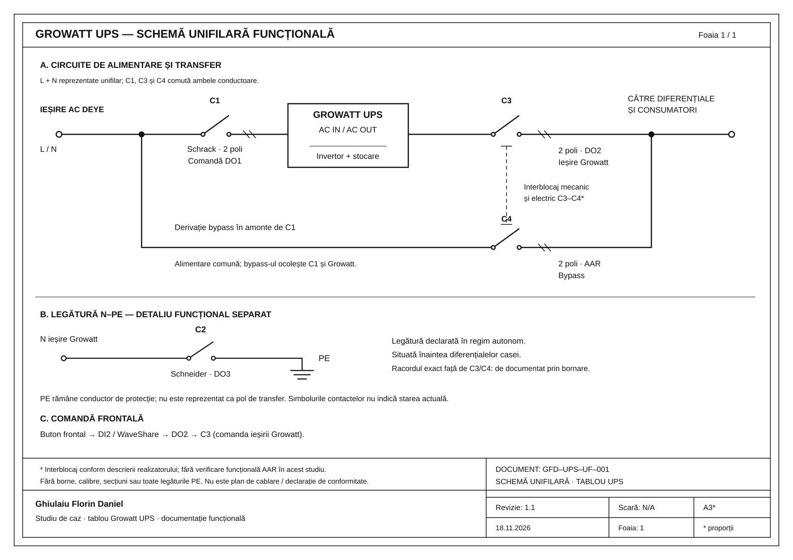

# Arhitectură de comandă locală și supraveghere pentru un sistem UPS cu invertor Growatt

**Ghiulaiu Florin Daniel**  
Studiu de caz tehnic aplicativ · 18 noiembrie 2026

## Rezumat

Lucrarea prezintă arhitectura unui sistem de comandă pentru un invertor Growatt utilizat ca sursă neîntreruptibilă cu stocare. Implementarea folosește un controler WaveShare ESP32-S3-POE-ETH-8DI-8DO, platforma ESPHome și integrarea Home Assistant. Trei ieșiri comandă alimentarea AC, conectarea consumatorilor și contactorul destinat legăturii dintre conductorul neutru și conductorul de protecție în regim autonom. O pereche de contactori cu interblocaj mecanic și electric, conform configurației declarate a instalației, asigură funcția de transfer către bypass. Analiza configurației evidențiază separarea funcțiilor și temporizarea comenzilor, precum și diferența dintre starea logică a unei ieșiri și starea fizică a circuitului de putere. Studiul are caracter descriptiv; eficacitatea protecțiilor și performanțele transferului nu au fost evaluate prin măsurători în cadrul lucrării.

**Cuvinte-cheie:** UPS; Growatt; ESPHome; Home Assistant; neutru; N–PE; protecție diferențială; interblocare; AAR.

## 1. Introducere

Utilizarea unui invertor cu baterie pentru alimentarea de rezervă a unei locuințe impune coordonarea alimentării AC, a conectării consumatorilor și a regimului conductorului neutru. Continuitatea alimentării și protecția la defect reprezintă obiective distincte: prezența tensiunii la ieșire nu demonstrează, singură, condițiile de funcționare a protecțiilor.

Obiectivul lucrării este descrierea unei implementări locale cu funcții separate de comandă și supraveghere. În instalația analizată, intrarea AC a Growatt poate fi alimentată din sistemul DEYE; absența acestei alimentări nu este considerată automat echivalentă cu absența rețelei publice.

### 1.1. Obiectivul și domeniul studiului

Studiul urmărește integrarea a trei niveluri funcționale: comutația circuitelor de alimentare, execuția locală a comenzilor și supravegherea centralizată. Delimitarea acestor niveluri permite analiza separată a continuității alimentării, a tratării neutrului și a disponibilității informației pentru operator.

Contribuția aplicativă constă în documentarea unei arhitecturi concrete, în care același controler deservește intrările de operare locală, comenzile contactorilor, semnalizarea optică și telemetria invertorului. Lucrarea analizează corespondența dintre intenția funcțională a instalației și comportamentul identificabil în configurația software. Principiile generale ale protecției diferențiale și ale interblocării constituie fundamentul tehnic al analizei, nu revendicări de noutate asupra acestor principii.

## 2. Fundament teoretic

### 2.1. Principiul protecției diferențiale

Într-un circuit monofazat, diferențiala monitorizează faza și nulul. În regim normal, curentul care pleacă pe fază revine prin nul, iar contribuțiile lor se compensează. Dacă o parte revine printr-un traseu exterior conductoarelor monitorizate, apare curentul rezidual. Pentru o reprezentare simplificată:

**IΔ = |IL − IN|**

De exemplu, 5 A pe fază și 4,96 A pe nul înseamnă 40 mA întorși pe alt traseu. Este un exemplu numeric, nu o măsurătoare a instalației. Declanșarea depinde de caracteristicile protecției și ale curentului rezidual. Diferențiala nu detectează direct „prezența împământării”; detectează dezechilibrul. [4]

### 2.2. Ieșirea flotantă și primul defect

O sursă poate furniza tensiunea nominală între conductoarele sale fără ca unul dintre ele să aibă o referință intenționată de impedanță redusă față de pământ. La un prim defect între un conductor activ și o carcasă legată la PE, curentul este influențat de impedanțele de izolație și de capacitățile față de pământ. El poate fi insuficient pentru declanșarea protecției diferențiale.

Aceasta nu înseamnă că orice sursă flotantă este interzisă. Sistemele IT sunt proiectate pentru un asemenea regim, cu măsuri specifice de supraveghere a izolației și de tratare a defectelor. O locuință alimentată accidental cu o ieșire flotantă nu trebuie considerată automat o instalație IT proiectată și verificată. [5]

### 2.3. Rolul legăturii N–PE la sursa autonomă

Într-o schemă care prevede referențierea sursei, legătura N–PE contribuie la închiderea buclei de defect. Conceptual, pentru un defect fază–carcasă, traseul este:

**sursă → fază monitorizată → defect → carcasă → PE → legătura la neutru a sursei → sursă.**

Returul prin PE nu traversează nulul monitorizat al circuitului în același mod ca returul normal al sarcinii, permițând apariția dezechilibrului. Legătura aparține schemei sursei, în poziția stabilită față de diferențiale; nu se adaugă arbitrar în prize sau după protecții. Continuitatea PE rămâne necesară. [1, 4]

### 2.4. Coordonarea referinței N–PE cu alimentarea AC

Într-un invertor/încărcător, referința sursei poate diferi între funcționarea autonomă și alimentarea dintr-o sursă externă. O legătură suplimentară neprevăzută poate crea trasee paralele N–PE, curenți prin conductoarele de protecție și declanșări nedorite. Configurația trebuie analizată pentru fiecare regim, inclusiv bypass. [1]

Ca exemplu de implementare de producător, manualul Victron Quattro-II descrie un releu intern care leagă neutrul ieșirii la carcasă în absența alimentării AC externe. La revenirea acesteia, releul de legare se deschide înaintea închiderii releului de intrare. Este ilustrată astfel coordonarea dintre referința sursei și transferul alimentării. Această funcție documentată la Victron nu dovedește existența sau comportamentul identic al unei funcții în Growatt. [6]

### 2.5. Aplicarea principiului în studiul de caz

În instalația descrisă, contactorul Schneider C2 este destinat legăturii N–PE în regim pe baterie, cu alimentarea AC Growatt deconectată. C1 comandă alimentarea AC, iar C3/C4 aparțin căilor de ieșire și bypass. Asocierea dintre funcții și comenzi este cea declarată de realizator.

| Regim analizat | Aspect care trebuie stabilit prin schemă și verificare |
|---|---|
| Alimentare AC Growatt | Originea referinței N–PE și evitarea unei legături suplimentare neprevăzute |
| Funcționare autonomă | Referința sursei Growatt și traseul de defect prin PE |
| Bypass AAR | Referința sursei de bypass și separarea circuitelor corespunzătoare |
| Transfer între regimuri | Pozițiile reale ale contactorilor și coordonarea legăturii N–PE |

Codul analizat urmărește complementaritatea DO1/DO3, însă condiția „DO1 oprit” nu demonstrează fizic absența tensiunii sau izolarea nulului. Scopul declarat al C2 este, așadar, documentat separat de validarea realizării sale. Testarea diferențialelor în fiecare regim și verificarea schemei complete sunt necesare înaintea unei concluzii privind protecția efectivă a casei.

## 3. Materiale și metodă

Metoda constă în analiza configurației ESPHome, identificarea entităților Home Assistant și corelarea acestora cu fotografia și descrierea funcțională a tabloului. Fișierul analizat este `gorwatt-cu-stari-si-automatizar.yaml`; identitatea sa cu firmware-ul instalat nu a fost verificată printr-un identificator de build.

**Figura 1.** Tabloul de comandă și comutație al instalației.

**Figura 3.** Reprezentarea unifilară a căilor de alimentare și detaliul funcțional al legăturii N–PE.

| Reper | Componentă | Funcție |
|---|---|---|
| C1 | Contactor Schrack, jos în stânga | Alimentarea AC a invertorului Growatt |
| C2 | Contactor Schneider, central | Comanda legăturii N–PE în regim autonom |
| C3 | Primul contactor mare din dreapta | Conectarea ieșirii Growatt către consumatori |
| C4 | Contactorul mare din extrema dreaptă | Alimentarea prin bypass în ansamblul AAR |

Reperele C1–C4 sunt utilizate în lucrare pentru identificarea funcțională. Perechea C3–C4 este descrisă ca având interblocaj mecanic și electric. Schema completă a AAR nu a făcut parte din materialul analizat.

### 3.1. Schema unifilară funcțională a tabloului

Conform precizărilor realizatorului, C1, C3 și C4 comută atât faza, cât și nulul. Alimentarea principală a Growatt provine din ieșirea DEYE, prin C1. Ieșirea Growatt este conectată către consumatori prin C3. C4 este alimentat din aceeași ramură AC ca intrarea C1, printr-o derivație în amonte de acest contactor. Bypass-ul ocolește astfel C1 și invertorul Growatt; nu reprezintă o sursă energetică independentă și nu elimină dependența de alimentarea comună din amonte. C3 și C4 aparțin ansamblului AAR cu interblocaj mecanic și electric declarat.

Legătura N–PE comandată prin C2 este situată înaintea diferențialelor casei, conform realizatorului. Detaliul este reprezentat separat deoarece punctul exact al racordului față de C3/C4 nu a fost documentat printr-o schemă de borne. PE nu este reprezentat ca un conductor comutat între surse.

Schema sintetizează funcțiile declarate. Nu include borne, dimensionări, protecții DC, toate legăturile PE sau logica electrică completă AAR. Nu constituie o schemă de execuție ori confirmarea că referința N–PE este corectă în fiecare regim de transfer.

### 3.2. Metodologia analizei funcționale

Analiza este organizată pe trei categorii de informație. Prima categorie cuprinde elementele observabile în configurația ESPHome: asocierile intrare–ieșire, condițiile de activare, temporizările și semnalizarea. A doua categorie cuprinde topologia declarată de realizator: funcțiile contactorilor, derivația de bypass, comutarea fazei și nulului și poziționarea legăturii N–PE înaintea diferențialelor. A treia categorie privește comportamentul fizic al ansamblului, care necesită verificări instrumentate distincte.

Trasabilitatea este menținută prin utilizarea acelorași repere C1–C4 și DO1–DO3 în text, tabele și schemă. Pentru fiecare funcție sunt diferențiate semnalul de intrare, comanda emisă și efectul fizic intenționat. Această metodă evită echivalarea unei stări software cu poziția efectivă a unui contact sau cu prezența tensiunii într-un circuit.

Interpretarea documentației producătorilor este utilizată pentru explicarea principiilor. Aplicarea acestora la instalația analizată este raportată la configurația disponibilă, fără extrapolarea automată a caracteristicilor unui echipament asupra altui model.

## 4. Arhitectura de comandă

Cele trei ieșiri ESPHome sunt asociate unor funcții distincte:

| Ieșire | Denumire în configurație | Element comandat |
|---|---|---|
| DO1 | `DO1 Retea` | C1 – alimentare AC |
| DO2 | `DO2 Sarcina` | C3 – conectarea consumatorilor |
| DO3 | `DO3 Nul Invertor` | C2 – legătură N–PE |

Această separare permite coordonarea alimentării, a sarcinii și a referinței neutru–protecție. Funcția de bypass introduce al patrulea contactor, C4, distinct de cele trei elemente asociate direct ieșirilor DO1–DO3.

DO1 și DO3 formează un grup de interblocare software. Pentru DO1 este configurat `interlock_wait_time: 1s`, iar pentru DO3, `interlock_wait_time: 2s`. La oprirea DO1, o secvență așteaptă 2 s și verifică dacă DO1 este încă oprit înainte de a solicita activarea DO3.

La inițializare, programul așteaptă 3 s, solicită DO3 activ dacă DO1 este oprit și permite ulterior acționarea DI1. DI1 comută DO1 la schimbarea stării, iar DI2 comandă pornirea și oprirea DO2.

### 4.1. Semnalizarea optică a stării prin LED RGB

LED-ul RGB al controlerului WaveShare oferă un indicator vizual sintetic al comenzilor de alimentare și de conectare a consumatorilor. Codificarea cromatică permite recunoașterea rapidă a stării de la distanță, fără consultarea interfeței Home Assistant, în condiții de vizibilitate corespunzătoare.

| Culoare LED | DO1 – alimentare AC | DO2 – sarcină | Semnificație operațională |
|---|---|---|---|
| 🟢 **Verde** | ON | ON | Alimentarea AC și conectarea consumatorilor sunt comandate |
| 🔵 **Albastru** | ON | OFF | Alimentarea AC este comandată; conectarea consumatorilor nu este comandată |
| 🟡 **Galben** | OFF | ON | Alimentarea AC nu este comandată; conectarea consumatorilor este comandată |
| 🔴 **Roșu** | OFF | OFF | Nici alimentarea AC, nici conectarea consumatorilor nu sunt comandate |

În configurația analizată, culoarea este reevaluată local la fiecare secundă, iar luminozitatea este setată la 80%. Indicatorul rămâne astfel legat de logica executată pe controler, fără a necesita deschiderea dashboard-ului pentru interpretare.

Semnalizarea reprezintă combinația stărilor software DO1 și DO2. Galbenul este compatibil cu funcționarea autonomă intenționată, dar nu confirmă singur că invertorul furnizează energie din baterie. Roșul desemnează combinația ambelor comenzi oprite și nu constituie, în această logică, un cod dedicat de avarie. DO3, pozițiile fizice ale contactorilor și starea AAR nu sunt incluse direct în calculul culorii.

### 4.2. Comanda locală prin butonul panoului frontal

Panoul frontal include un organ de comandă conectat la intrarea digitală DI2 a controlerului. Conform realizatorului, acționarea acestuia comandă oprirea contactorului C3, asociat ieșirii de tensiune a invertorului Growatt. Interfața locală facilitează intervențiile asupra sistemului fără consultarea dashboard-ului Home Assistant și permite inițierea locală a retragerii căii Growatt în vederea utilizării bypass-ului.

| Element funcțional | Rol în operarea locală |
|---|---|
| Buton frontal / intrare DI | Introducerea comenzii locale |
| DO2 / contactor C3 | Comanda conectării sau deconectării ieșirii Growatt |
| Contactor C4 / ansamblu AAR | Calea de bypass, supusă logicii de transfer și interblocajului C3–C4 |

În configurația ESPHome analizată, DI2 comandă DO2 la apăsare și eliberare, în timp ce DI1 comută DO1 la schimbarea stării. Realizatorul a confirmat conectarea comenzii frontale la DI2. Efectul declarat al butonului este deconectarea comandată a ieșirii Growatt; activarea automată a C4 ca urmare a acestei acțiuni nu a fost confirmată în materialul analizat.

Din perspectiva utilizării, comanda frontală oferă un punct de intervenție accesibil și intuitiv, complementar semnalizării RGB. Totuși, culoarea LED-ului indică stările software DO1/DO2 și nu confirmă poziția contactorului de bypass. Confirmarea că sarcina a fost transferată necesită informații despre starea AAR și despre alimentarea efectivă a consumatorilor.

Pentru mentenanță, oprirea C3 reprezintă retragerea comandată a căii de ieșire, nu izolarea completă a invertorului. Alimentările AC, bateria și eventualele circuite fotovoltaice rămân surse distincte de energie. Butonul nu este prezentat ca separator de siguranță sau ca substitut al izolării și verificării absenței tensiunii înaintea intervenției.

## 5. Integrarea Home Assistant

Comunicarea cu Home Assistant se realizează prin integrarea nativă ESPHome [3]. Controlerul execută secvența locală, iar Home Assistant oferă acces la entitățile de comandă și la informațiile disponibile.

| Entitate | Mărime reprezentată |
|---|---|
| `switch.waveshare_di8_do8_do1_retea` | Comanda alimentării AC |
| `switch.waveshare_di8_do8_do2_sarcina` | Comanda conectării consumatorilor |
| `switch.waveshare_di8_do8_do3_nul_invertor` | Comanda legăturii N–PE |

Aceste entități reprezintă stări logice de comandă. Confirmarea poziției contactorilor necesită reacții fizice distincte. Indisponibilitatea comunicației constituie lipsă de informație și nu este echivalentă cu starea oprit.

### 5.1. Control și telemetrie pe același echipament

Același controler WaveShare este utilizat, conform realizatorului, atât pentru comenzile locale, cât și pentru preluarea datelor Growatt și transmiterea lor către Home Assistant. Instalația reunește astfel funcțiile de achiziție și comandă într-un singur echipament. În această lucrare, WaveShare este identificat ca un controler bazat pe ESP32 cu intrări și ieșiri; utilizarea sa nu implică o clasificare de PLC de siguranță.

Datele actualizate în Home Assistant permit corelarea comenzilor cu parametrii raportați de invertor: tensiuni, puteri, stare de încărcare și celelalte mărimi expuse de configurație. Actualizarea depinde de ciclul de interogare și de comunicație; termenul „live” nu desemnează o măsurare continuă sau un sistem cu timp real garantat. Telemetria invertorului nu înlocuiește reacțiile de poziție ale contactorilor.

### 5.2. Distribuția funcțiilor între ESPHome și Home Assistant

Secvența de interblocare și temporizare este definită în ESPHome și executată pe controler. Comanda unei intrări locale poate fi procesată fără ca fiecare tranziție să parcurgă un traseu intrare–rețea–server Home Assistant–rețea–ieșire. Home Assistant concentrează afișarea, istoricul și comenzile de nivel superior, în timp ce secvența locală păstrează coordonarea ieșirilor pe același dispozitiv.

| Funcție | Rolul atribuit în această implementare |
|---|---|
| Buton frontal DI2 și ieșire DO2 | Tratare locală pe WaveShare |
| Interblocare DO1/DO3 și întârzieri | Execuție locală în ESPHome |
| Indicator RGB | Evaluare locală a stărilor DO1/DO2 |
| Date Growatt | Achiziție și expunere prin controler |
| Dashboard, istoric, supraveghere | Home Assistant |

Avantajul arhitecturii este reducerea dependenței secvenței locale de funcționarea serverului și de schimbul de mesaje pentru fiecare pas. O oprire a Home Assistant nu reprezintă, prin definiție, oprirea unei secvențe locale. Totuși, comportamentul efectiv la lipsa comunicației trebuie verificat împreună cu setările ESPHome: parametrul API `reboot_timeout` poate determina repornirea dispozitivului în absența unui client. Această opțiune și logica de inițializare trebuie analizate împreună. [7]

Concentrarea funcțiilor pe un singur controler introduce și o dependență comună: pierderea alimentării sau defectarea WaveShare poate afecta simultan comanda și telemetria. Execuția locală nu înlocuiește interblocajele hardware, protecțiile electrice sau verificarea circuitelor de putere. Alegerea ESPHome urmărește distribuția funcțiilor din acest studiu, nu o afirmație că orice automatizare Home Assistant ar fi nepotrivită.

## 6. Rezultatele analizei

Analiza fișierului confirmă existența separării DO1–DO3, a interblocării software și a temporizărilor configurate. Activarea DO3 este condiționată de starea logică DO1, fără o verificare explicită a absenței tensiunii AC sau a poziției C1 în secvența examinată.

În consecință, configurația demonstrează coordonarea comenzilor, dar nu demonstrează izolarea fizică a sursei. Timpii configurați nu reprezintă măsurători ale deschiderii contactelor sau timpi certificați de transfer UPS. Funcționarea AAR și interblocajul C3–C4 sunt descrise pe baza informațiilor realizatorului, fără test funcțional inclus în studiu.

### 6.1. Sinteza funcțională a arhitecturii

| Nivel analizat | Rezultat al examinării | Semnificație tehnică |
|---|---|---|
| Alimentare | Două căi din aceeași ramură AC, cu derivație înainte de C1 | Bypass-ul ocolește C1 și Growatt, fără independență energetică față de sursa comună |
| Comandă | Funcții distincte pentru DO1, DO2 și DO3 | Separarea alimentării, a conectării consumatorilor și a tratării nulului |
| Operare locală | Buton frontal confirmat pe DI2, asociat DO2 | Posibilitatea retragerii comandate a ieșirii Growatt fără accesarea dashboard-ului |
| Semnalizare | Cod RGB derivat din DO1 și DO2 | Identificarea vizuală a combinației comenzilor |
| Supraveghere | Telemetrie și comenzi expuse prin același controler | Corelarea datelor invertorului cu stările de comandă în Home Assistant |
| Disponibilitate | Execuție locală, cu resurse hardware comune | Reducerea dependenței secvenței de server, concomitent cu existența unui punct comun de defectare |

Rezultatele susțin caracterizarea arhitecturii ca sistem de comandă locală cu supraveghere centralizată. Ele nu constituie măsurători de performanță ale protecțiilor sau ale transferului de putere.

## 7. Discuție și limite

Interblocarea software facilitează exclusivitatea logică a comenzilor, însă nu înlocuiește măsurile hardware. Documentația ESPHome evidențiază limitele acestei funcții în prezența erorilor software și în timpul resetării [2]. Interblocajul C3–C4 nu constituie dovada unui interblocaj fizic între C1 și C2.

Validarea electrică necesită schema completă L/N/PE, regimul de împământare, caracteristicile invertorului și protecțiilor, precum și verificări în regim AC, autonom și bypass. Nu sunt disponibile în cadrul lucrării rezultate de continuitate PE, teste instrumentate ale diferențialelor, măsurători ale buclei de defect sau înregistrări ale transferului. Prin urmare, nu se formulează o concluzie de conformitate sau certificare a instalației.

## 8. Concluzii

Implementarea descrisă separă comanda alimentării AC, conectarea consumatorilor și tratarea nulului într-o arhitectură locală integrată în Home Assistant. Arhitectura reunește operarea frontală, semnalizarea optică și telemetria într-un controler comun, cu separarea rolului de comandă față de rolul de supraveghere. Contribuția studiului constă în documentarea acestei implementări și în analiza relației dintre comenzile logice și funcțiile fizice intenționate. Confirmarea eficacității protecțiilor și a comportamentului în avarie rămâne condiționată de verificarea electrică și de documentarea experimentală.

## Referințe

1. Victron Energy. *Wiring Unlimited*, capitolul 7: [Ground, earth and electrical safety](https://www.victronenergy.com/media/pg/The_Wiring_Unlimited_book/en/ground%2C-earth-and-electrical-safety.html).
2. ESPHome. [GPIO Switch – Interlocking](https://esphome.io/components/switch/gpio/).
3. Home Assistant. [ESPHome integration](https://www.home-assistant.io/integrations/esphome/).
4. Schneider Electric, *Electrical Installation Guide*. [Description of RCDs](https://www.electrical-installation.org/enwiki/Description_of_RCDs).
5. Schneider Electric, *Electrical Installation Guide*. [IT system – Principle](https://www.electrical-installation.org/enwiki/IT_system_-_Principle).
6. Victron Energy, *Quattro-II 230V*. [Installation – ground relay](https://www.victronenergy.com/media/pg/Quattro-II_230V/en/installation.html).
7. ESPHome. [Native API Component – reboot_timeout](https://esphome.io/components/api/).

---

© 2026 Ghiulaiu Florin Daniel. Toate drepturile rezervate pentru contribuțiile originale asupra cărora autorul deține drepturi. Drepturile terților și termenii GitHub rămân aplicabili. [Condiții de utilizare](LICENSE).
