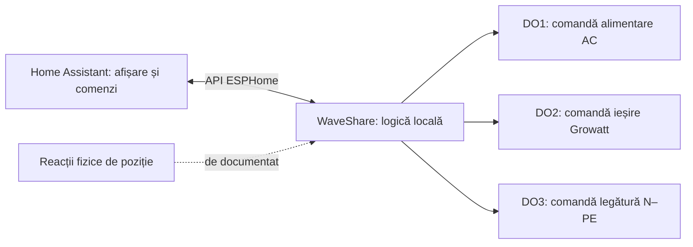

# Integrarea în Home Assistant

## Arhitectura integrării



Săgețile sunt relații funcționale, nu o schemă de conexiuni electrice.

## Conectare, pas cu pas

1. Conectează controlerul și Home Assistant în rețeaua locală potrivită.
2. În Home Assistant deschide **Settings / Configurare → Devices & services / Dispozitive și servicii**.
3. Dacă dispozitivul ESPHome este descoperit, deschide configurarea lui. Altfel alege **Add integration → ESPHome** și introdu numele local sau IP-ul controlerului tău.
4. Folosește cheia API de criptare dacă dispozitivul o are configurată. Nu o publica în repository.
5. Verifică dispozitivul și entitățile create. Numele sunt locale și pot diferi de exemplul de mai jos.

Acești pași privesc integrarea unui controler deja configurat. Nu includ flash, modificări ale protecțiilor sau comenzi de test către contactori. Referință: [integrarea oficială ESPHome](https://www.home-assistant.io/integrations/esphome/).

## Entități identificate în inventarul local

| Entitate | Etichetă recomandată |
|---|---|
| `switch.waveshare_di8_do8_do1_retea` | Alimentare AC Growatt – comandă |
| `switch.waveshare_di8_do8_do2_sarcina` | Ieșire Growatt – comandă |
| `switch.waveshare_di8_do8_do3_nul_invertor` | Legătură N–PE – comandă |
| `binary_sensor.waveshare_di8_do8_di2` | Intrare DI2 – semnal |

Identificatorii au fost găsiți într-un inventar Home Assistant local. Existența lor în inventar nu reprezintă un test de poziție a contactorilor. Nu atribuim DI2 rolul de contact auxiliar confirmat în lipsa unei scheme.

## Card de afișare, fără butoane de comutare

Exemplul folosește doar afișare Markdown. Nu cheamă servicii și nu oferă comutarea releelor:

```yaml
type: markdown
title: Growatt UPS · comenzi
content: >-
  
  
  
  

  **Alimentare AC Growatt:** {{ names.get(a, 'NECUNOSCUT') }}

  **Ieșire către consumatori:** {{ names.get(b, 'NECUNOSCUT') }}

  **Legătură N–PE:** {{ names.get(c, 'NECUNOSCUT') }}

  *Stări de comandă, fără confirmare mecanică a contactorilor.*
```

Pentru adăugare, editează dashboard-ul ales, adaugă un card manual și inserează exemplul după ce verifici identificatorii. Nu este necesară instalarea unui card custom. Exemplul nu a fost instalat sau testat live în cadrul publicării acestui articol.

## Separarea dintre automatizări

Regulile de încărcare după SOC și comenzile din dashboard nu sunt echivalente cu secvența locală DO1/DO3. Oprirea unei automatizări Home Assistant nu înseamnă că a fost dezactivată logica definită în ESPHome. Înaintea oricărei intervenții trebuie cunoscute toate sursele de comandă.

## Disponibilitate și informație lipsă

O entitate indisponibilă se afișează ca atare, fără transformare în OFF. Ultima comandă cunoscută nu dovedește starea fizică actuală. Pentru o supraveghere mai completă trebuie documentate separat reacțiile auxiliare, măsurarea AC și semnalele AAR. Acestea nu sunt pretinse ca existente în acest exemplu.
