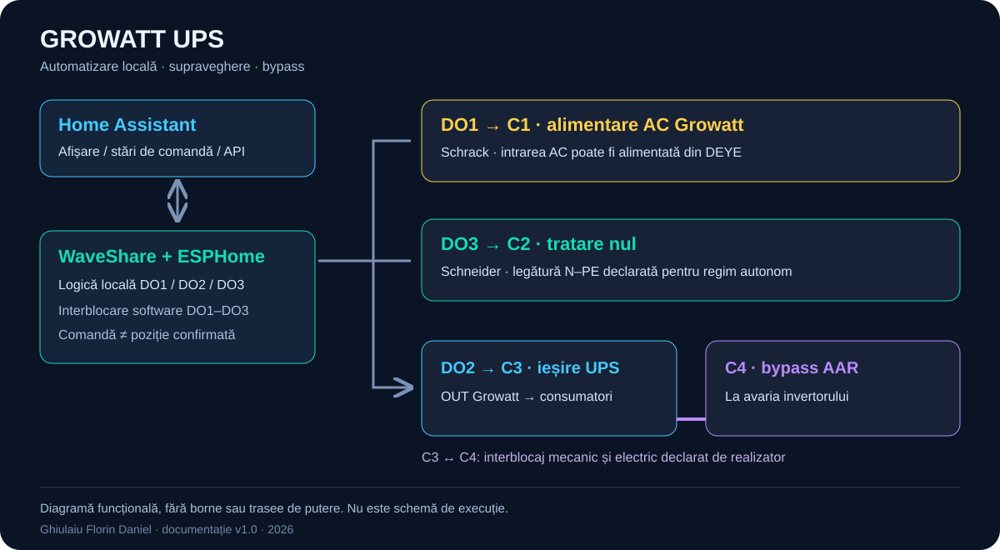
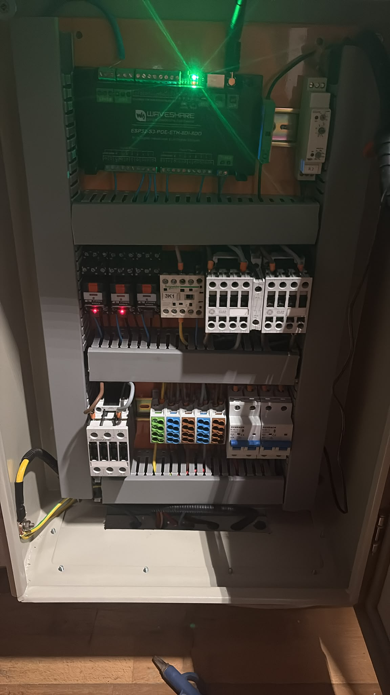

# Growatt UPS · automatizare locală și tratarea nulului

### Proiect realizat de Ghiulaiu Florin Daniel

**WaveShare ESP32-S3 · ESPHome · Home Assistant · contactori · bypass AAR**

Acest proiect documentează o instalație personală în care un invertor Growatt este folosit ca UPS cu stocare. Trei ieșiri ale controlerului comandă alimentarea AC, conectarea consumatorilor și contactorul pentru tratarea nulului. Un ansamblu separat de contactori interblocați permite bypass-ul în cazul avariei invertorului.

> **Statut: studiu de caz tehnic, versiunea 1.0.** Documentația descrie configurația citită și informațiile furnizate de realizator. Nu este o schemă de execuție, o certificare de siguranță sau o soluție universală pentru orice invertor și orice instalație.

## De ce acest proiect?

Scopul este coordonarea unor funcții diferite, fără a le amesteca: alimentarea invertorului, livrarea energiei către consumatori și comanda legăturii N–PE în regim autonom. ESPHome execută logica locală, iar Home Assistant oferă vizibilitate asupra comenzilor și a datelor disponibile.

În instalația descrisă, alimentarea AC a Growatt poate proveni din sistemul DEYE. Prin urmare, „rețea” din denumirea DO1 înseamnă aici **alimentarea AC de intrare a Growatt**; nu dovedește că rețeaua publică este prezentă.

## Fotografia instalației

*Fotografie furnizată de Ghiulaiu Florin Daniel. Identificarea de mai jos se bazează pe explicațiile realizatorului; fotografia nu permite urmărirea completă a cablajului.*

| Reper documentar | Componentă și poziție | Funcție declarată |
|---|---|---|
| C1 | Schrack, jos în stânga | Alimentare AC de intrare Growatt |
| C2 | Schneider, central | Închiderea legăturii N–PE în regim autonom |
| C3 | Primul contactor mare la dreapta Schneiderului | Conectarea ieșirii OUT Growatt către consumatori |
| C4 | Contactorul mare din extrema dreaptă | Calea de bypass prin AAR |

**C1–C4 sunt repere ale documentației**, nu etichete pretins existente pe aparate. Conform realizatorului, C3 și C4 au interblocaj mecanic și electric. Modelele exacte, numărul polilor utilizați și conexiunile bornelor nu sunt certificate prin această fotografie.

## Citește documentația

| Document | Ce conține |
|---|---|
| [Articolul tehnic](ARTICOL.md) | Motivație, diferențiale, nul flotant și rolul contactorilor |
| [Logica ESPHome](AUTOMATIZARE.md) | Ce face efectiv codul, întârzieri, repornire și limite |
| [Integrarea Home Assistant](HOME_ASSISTANT.md) | Conectare, entități și un exemplu de afișare fără comenzi |
| [Validare și scenarii de defect](VALIDARE.md) | Ce trebuie măsurat și ce nu este încă demonstrat |
| [Surse și atribuiri](SURSE.md) | Documentație oficială și delimitarea contribuțiilor |
| [Ghid pentru întreținerea paginii](GHID_GITHUB.md) | Editare, încărcare fotografii și versiuni |

## Trei relee de comandă, patru contactori

| Ieșire ESPHome | Nume în configurația citită | Rol asociat |
|---|---|---|
| DO1 | `DO1 Retea` | Comanda C1 – alimentare AC |
| DO2 | `DO2 Sarcina` | Comanda C3 – ieșire către consumatori |
| DO3 | `DO3 Nul Invertor` | Comanda C2 – legătură N–PE |
| AAR separat | Nu este demonstrat în extrasul ESPHome | Comanda transferului/bypass-ului C3–C4 |

Nu sunt patru funcții comprimate în trei contactori. Calea de bypass introduce un al patrulea contactor, distinct de cele trei funcții comandate prin DO1–DO3.

## Ce este demonstrat și ce rămâne de verificat

- **Citit în fișier:** interblocarea software DO1/DO3, temporizări, intrări DI1/DI2 și inițializarea la pornire.
- **Descris de realizator:** rolurile fizice C1–C4 și interblocajul mecanic/electric C3–C4.
- **Nedemonstrat:** poziția reală a contactelor, schema completă N/PE, funcționarea diferențialelor în fiecare regim și timpii reali de transfer.

Starea `ON` a unui switch este o **stare de comandă**. Fără contacte auxiliare și măsurători corespunzătoare, nu constituie confirmarea poziției contactorului sau a absenței tensiunii.

## Drepturi și utilizare

**© 2026 Ghiulaiu Florin Daniel. Toate drepturile rezervate pentru contribuțiile originale asupra cărora autorul deține drepturi.**

Repository public pentru prezentare și documentare; nu este oferit sub o licență open-source. Se păstrează drepturile legale ale terților și permisiunile prevăzute de termenii GitHub, inclusiv vizualizarea și fork-ul în cadrul platformei. Vezi [LICENSE](LICENSE) și [NOTICE.md](NOTICE.md).

Publicarea aici nu este înregistrare de brevet și nu conferă exclusivitate asupra principiului electric. Nu se revendică inventarea tratării nulului, a interblocărilor, a ESPHome sau a Home Assistant.
